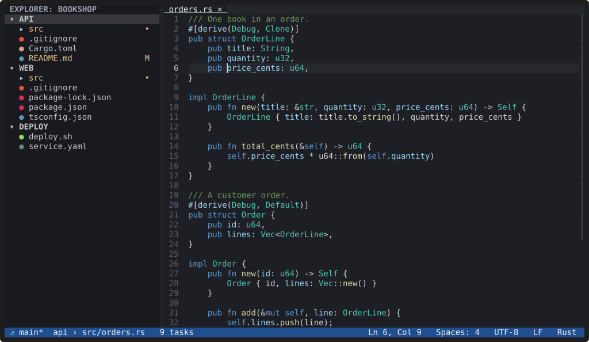
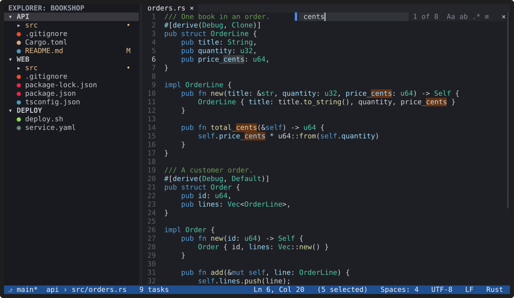

# Editing

**Editing works like VS Code: no modes, the same shortcuts, multiple
cursors, and saves that never corrupt a file.**

*Recording: `Ctrl+D` four times, then typing a new name.
[asciicast](../media/multi-cursor.cast)*

## Cursors and selections

- Multiple cursors: `Ctrl+D` adds the next match, `Ctrl+Shift+L` selects
  every occurrence, `Ctrl+Shift+Up` / `Ctrl+Shift+Down` add a cursor above
  or below, and `Alt+Click` adds one anywhere.
- Copy, cut and paste work with every cursor, and copy the whole line when
  nothing is selected. YACE uses the system clipboard, OSC 52 or an
  internal one, whichever is available.
- Movement is Unicode-correct: graphemes, wide characters and emoji count
  as one character. `Home` is smart (first non-blank character first).

## Changing text

- Word-wise undo and redo (`Ctrl+Z`, `Ctrl+Y`).
- Auto-indent, auto-closing brackets and quotes, and matching-bracket
  highlight.
- Move, copy and delete lines (`Alt+Up/Down`, `Shift+Alt+Up/Down`,
  `Ctrl+Shift+K`), toggle comments (`Ctrl+/`, `Shift+Alt+A`).
- Snippets and typed text can be bound to keys (see
  [commands that take arguments](../docs/keybindings.md#keybindingstoml)).

## Find and replace in a file

`Ctrl+F` opens the find bar and `Ctrl+H` adds the replace field. Match
case, whole word, regular expressions and "in selection" are toggles
(`Alt+C`, `Alt+W`, `Alt+R`, `Alt+L`). `Alt+Enter` turns every match into a
cursor; replace all is one undo step. The search follows your edits: in a
100,000-line file with 10,000 matches, a keystroke costs about 0.3 ms.

## Files

- Saves are atomic and keep the file's permissions; symlinks stay
  symlinks.
- Line endings are kept byte for byte (LF, CRLF and even mixed files), and
  UTF-8 with or without a BOM. Binary files and invalid UTF-8 are refused
  instead of being corrupted.
- When a file changes on disk, an unmodified editor reloads it; one with
  unsaved changes asks you what to do.
- Files above `files.largeFileThresholdMb` (50 MiB by default) open, after
  asking, in a reduced-feature mode.
- Auto-save, trimming trailing whitespace and a final newline are
  settings (`files.autoSave`, `files.trimTrailingWhitespace`,
  `files.insertFinalNewline`).

## Tabs and splits

Preview tabs (a single click or `Space` in the Explorer opens a tab that
the next preview replaces), reopen closed editors (`Ctrl+Shift+T`),
most-recently-used switching (`Ctrl+Tab`), split right or down
(`Ctrl+\`, `Ctrl+K Ctrl+\`), moving editors between groups, maximising a
group (`Ctrl+K Ctrl+M`), and resizing with the mouse.

See the [editor keys](../docs/keybindings.md#editor-editorfocus) for the
full list.
