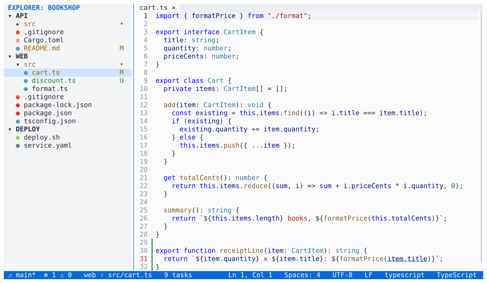

# Explorer

**The Explorer shows one tree per workspace folder, reads each directory
only when you expand it, and marks what Git sees as changed.**

## What it does

- **One tree per folder**, each under the folder's name (or the custom
  name the workspace file gives it). A folder that is missing on disk is
  shown as unavailable and never blocks the others.
- **Lazy and light.** A directory is read only when you expand it, on
  worker threads, and only expanded directories are watched for changes.
- **File operations:** new file (`Ctrl+Alt+N`) and new folder, rename
  (`F2`), move, delete to the Trash (`Delete`, after confirmation), and
  copy, cut and paste (`Ctrl+C`, `Ctrl+X`, `Ctrl+V`), also between
  workspace folders. Copies run in the background; an existing name gets
  " copy", " copy 2" and so on.
- **Type to filter** the visible entries; `Escape` clears the filter.
- **Open to the side** (`Ctrl+Enter`), reveal the active file
  (`Ctrl+K Ctrl+R`), reveal in the file manager (`Shift+Alt+R`), copy the
  path or the relative path (`Shift+Alt+C`, `Ctrl+Shift+Alt+C`), and open
  an integrated terminal in a folder.
- **Git status:** changed files are coloured and marked (`M` modified, `A`
  added, `U` untracked, `D` deleted, `R` renamed, `!` conflict), folders
  that contain changes get a dot, and ignored files are dimmed. See
  [Git](git.md).
- **File icons:** a coloured dot by default, or coloured file-type icons
  with a Nerd Font (`workbench.glyphs = "nerdFont"`; see
  [Installation](../installation.md#optional-file-icons)).
- **Mouse and layout:** the mouse works in the tree, `Ctrl+B` hides the
  side bar, and the side bar can sit on the right
  (`workbench.sideBarLocation`).

On a root folder, `F2` renames the folder's display name in the workspace
and `Delete` removes the folder from the workspace. Removing a folder never
deletes anything on disk.

See the [Explorer keys](../docs/keybindings.md#explorer-explorerfocus) and
the [`[explorer]` settings](../docs/configuration.md#explorer).
