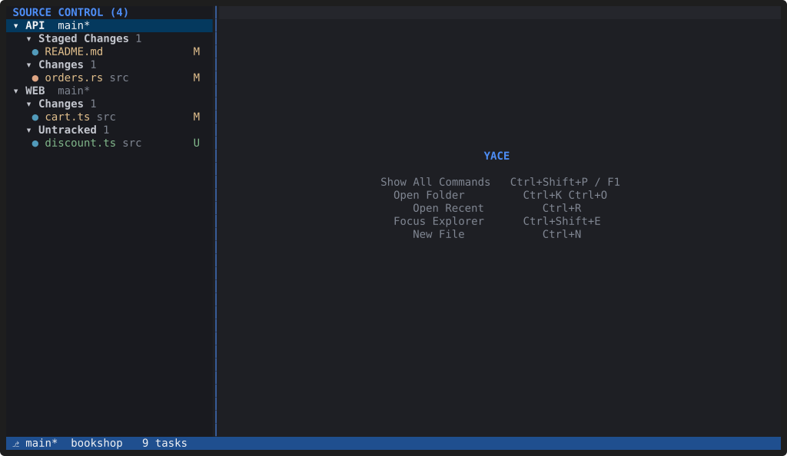
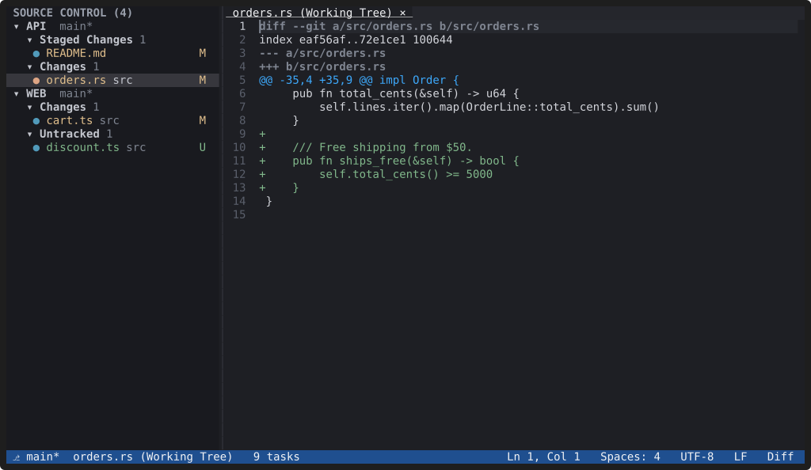

# Git

**Every workspace folder shows its own repository: its branch in the
status bar, its changes in the Explorer and the gutter, and its own
section in the Source Control view.** YACE runs the `git` you have
installed, on background threads, and only reads repositories unless you
ask it to change something.

## What you see

- **Status bar:** the branch of the active file's repository, with `*`
  when there are changes, `↑` and `↓` for commits ahead of and behind the
  upstream, and `⚠` with a count for merge conflicts.
- **Explorer:** changed files are coloured and marked (`M`, `A`, `U`, `D`,
  `R`, `!`); ignored files are dimmed.
- **Gutter:** bars mark lines that differ from the index, updated as you
  type, before you save. `Alt+F5` and `Shift+Alt+F5` jump between changes.
- **Source Control view** (`Ctrl+Shift+G`): one section per repository
  with Merge Conflicts, Staged Changes, Changes and Untracked. Press `s`
  or `u` to stage or unstage, `c` to commit, `b` to switch or create a
  branch, and `Enter` to see a file's changes.

## Safe by default

Opening a workspace and editing only *read* repositories, and those reads
never take Git's index lock, so they can't get in the way of the git
commands you run yourself. Staging, committing and switching branches
happen only when you ask. "Git: Show Output" lists every git command YACE
ran, with timings.

Changes made outside YACE (in a terminal, for example) show up because the
`.git` folder is watched. Each repository refreshes on its own, so a big
repository never delays the others.

Staging single hunks, discarding changes, history and a side-by-side diff
are not there yet. The [Git reference](../docs/git.md) has every command,
key and setting.
