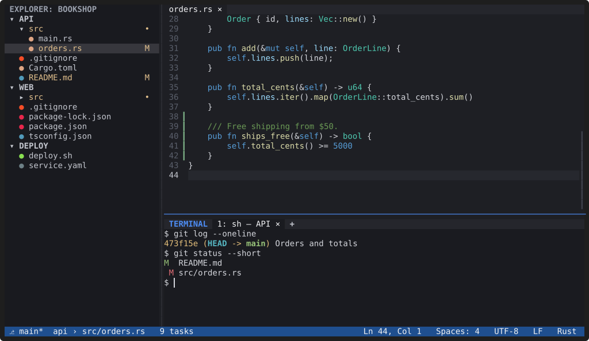

# Features

**YACE covers the everyday VS Code workflow in a terminal, across every
folder of a multi-root workspace.** Each page below shows one area, with
screenshots and short recordings made from the real editor.

| Area | Highlights |
|---|---|
| [Editing](editing.md) | multiple cursors, word-wise undo, auto-indent and brackets, safe saving, tabs and splits |
| [Explorer](explorer.md) | one tree per workspace folder, file operations, Git status, file icons |
| [Quick Open and search](search.md) | fuzzy file search, Command Palette, search and replace across folders with a preview |
| [Integrated terminal](terminal.md) | shells per folder, tabs, split panes, find in the scrollback, profiles |
| [Git](git.md) | branch per folder, changes in the Explorer and the gutter, Source Control view |
| [Language servers](language-servers.md) | completion, diagnostics, hover, go to definition, rename, formatting |
| [Syntax and folding](syntax.md) | tree-sitter highlighting, folding, word wrap, large files |
| [Themes](themes.md) | six built-in themes with live preview, your own themes, VS Code theme import |
| [Settings](settings.md) | layered TOML settings, VS Code settings in workspaces, live reload, a shortcuts editor |
| [Workspaces and sessions](workspaces.md) | `.code-workspace` files, unrelated folders together, restored sessions |

Native plugins add more: see [Using plugins](../plugins/using.md).

## Screenshots and recordings

The images on these pages are SVG files generated from the real editor by
a capture tool in the repository (`site/capture/`), so they can be
refreshed whenever the interface changes; see [This website](../contributing/website.md).
Recordings play in a loop; each has its [asciicast](https://docs.asciinema.org/manual/asciicast/v2/)
source next to it.
