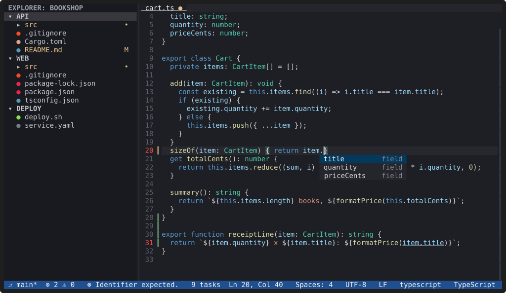
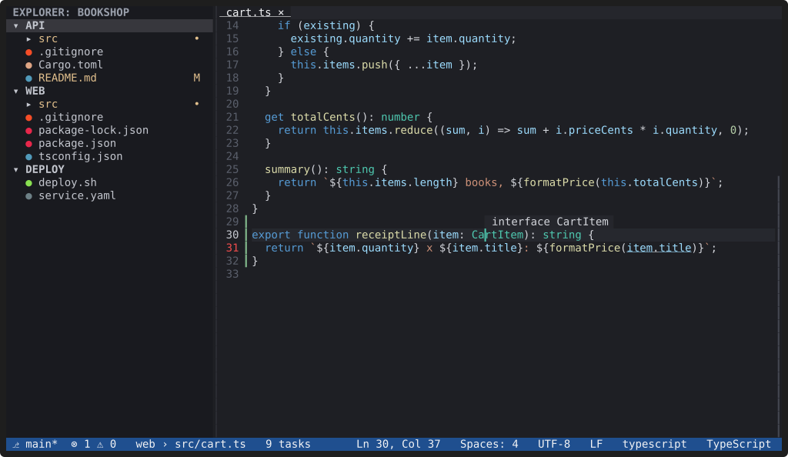

# Language servers

**YACE talks to the language servers you have installed, starting one per
workspace folder when you open a file of its language, for completion,
diagnostics, hover, go to definition, rename, code actions and
formatting.** It never installs anything.



## What you get

| Feature | Keys |
|---|---|
| Completion while you type | `Ctrl+Space` (enhanced terminals), or just type |
| The selected completion's documentation | shown in a panel beside the list; "Toggle Suggestion Details" (`Ctrl+Space` while the list is open, enhanced terminals) hides it |
| Parameter hints | `Ctrl+Shift+Space`, also on `(` and `,` |
| Hover | `Ctrl+K Ctrl+I` |
| Go to definition, also into other workspace folders | `F12`, `Ctrl+Click` |
| Go to implementations / references | `Ctrl+F12` / `Shift+F12` |
| Rename symbol | `F2` |
| Code actions and quick fixes | `Ctrl+.` |
| Format document / selection | `Ctrl+Shift+I` / `Ctrl+K Ctrl+F`, and `editor.formatOnSave` |
| Problems: diagnostics of every file | `Ctrl+Shift+M`; `F8` / `Shift+F8` for the next / previous problem |
| Go to symbol in the file / in the workspace | `Ctrl+Shift+O` / `Ctrl+T` |

The status bar shows the error and warning counts and the active server.



## Which servers

YACE knows `rust-analyzer`, TypeScript (its own server from TypeScript 7,
or `typescript-language-server` for older projects), `pyright` or
`pylsp`, `gopls`, `clangd`, `bash-language-server`,
`yaml-language-server`, the `vscode-*-language-server` family for JSON,
CSS and HTML, `taplo` and `marksman`, and uses each one it finds on your
`PATH`. You can add servers or change how one starts in your user
settings; a workspace can never choose which programs run. Servers stop a
while after their last file closes (`lsp.idleShutdownSecs`).

Node.js servers are external programs like any other; "Developer: Show
Running Language Servers" shows their memory separately from YACE's.

## ESLint, Biome and other servers next to the main one

A file can have more than one server. Plugins add linters and formatters
next to the language's own server:

```sh
yace --install-plugin io.github.abedmurrar.yace-eslint
yace --install-plugin io.github.abedmurrar.yace-biome
```

Each starts only in projects with its configuration file (`eslint.config.*`
or `.eslintrc*`, `biome.json`). Problems lists every server's problems with
their source, `Ctrl+.` offers all their fixes, and the status bar shows
`typescript + eslint`. To format with Biome instead of the TypeScript
server, set `editor.defaultFormatter = "biome"`.

The server list with install commands, and every setting, is in
[Configuration: `[lsp]`](../docs/configuration.md#lsp-user-settings-only).
The keys are under [Language features](../docs/keybindings.md#language-features-with-a-language-server).
