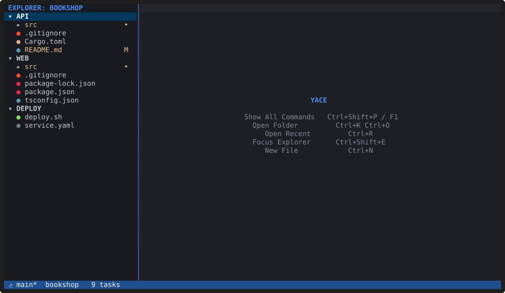
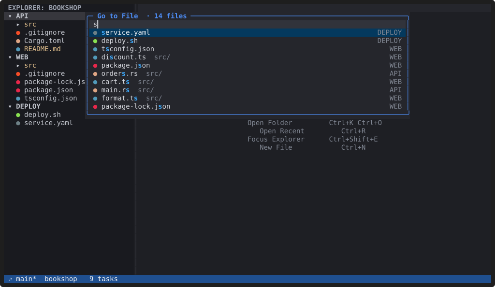
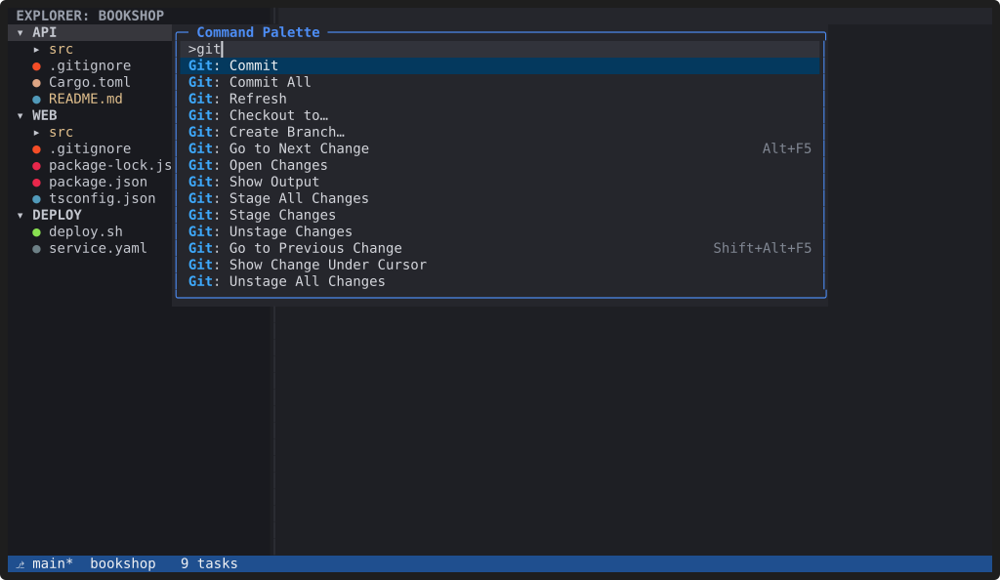
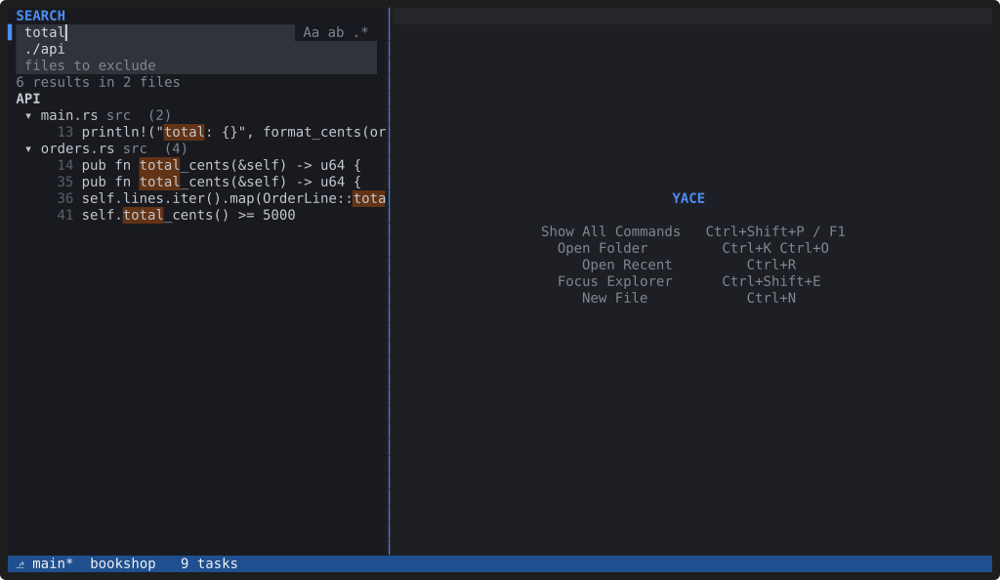
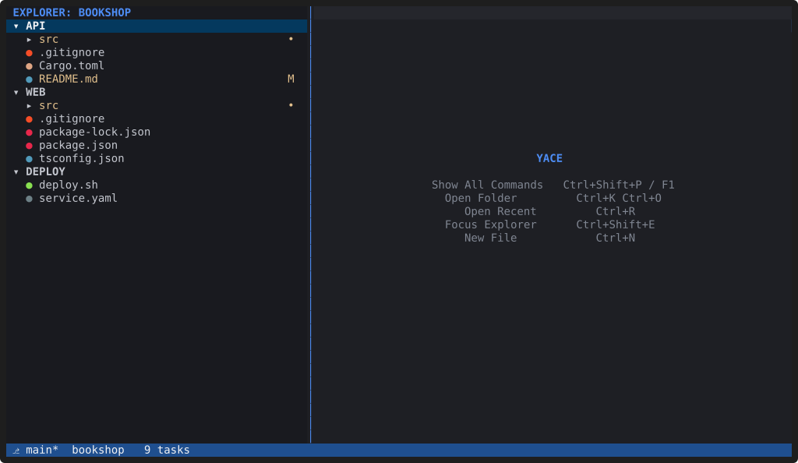
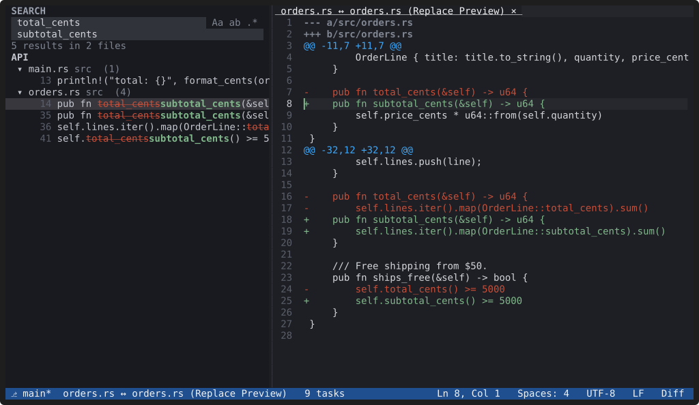

# Quick Open and search

**`Ctrl+P` finds any file in any workspace folder by a few letters of its
name; `Ctrl+Shift+F` searches the contents of every folder, and
`Ctrl+Shift+H` replaces with a preview of each change.**

## Quick Open (`Ctrl+P`)

*Recording: fuzzy matching across workspace folders.
[asciicast](../media/quick-open.cast)*

- Fuzzy matching: `jobserv` finds `jobs.service.ts`, and a word can match
  a folder name (`api index`). Each result shows its folder.
- `name:42` or `name:42:8` opens at a line and column; `:42` goes to a line
  in the current file; `>` switches to commands; `@` and `#` go to symbols
  (with a language server); `?` lists the modes.
- `Ctrl+Enter` opens the file to the side; `Alt+I` includes git-ignored
  files.
- The file list stays live. After the first Quick Open, YACE watches the
  folders it indexed (honouring `.gitignore`), so new and deleted files
  show up immediately. Indexing starts only when you first use Quick Open,
  and file names are cached in `~/.cache/yace/` so the next start is
  instant.

## Command Palette (`Ctrl+Shift+P` or `F1`)

Every command is in the Command Palette, with its shortcut. It is the
same box as Quick Open, starting with `>`.

## Search across the workspace (`Ctrl+Shift+F`)

The Search view searches as you type, in every workspace folder, and
honours `.gitignore` and `search.exclude`. Match case, whole word and
regular expressions are toggles (`Alt+C`, `Alt+W`, `Alt+R`). Type
`./Folder Name/…` in "files to include" to search one folder, or use "Find
in Folder…" (`Shift+Alt+F`) in the Explorer.

Results stay current: editing an open file, or creating, changing or
deleting a file on disk, updates that file's results without a new
search. Typing a longer query searches only the files that matched the
shorter one; in a 44,000-file repository the next keystroke takes about
25 ms instead of 183 ms.

## Replace across the workspace (`Ctrl+Shift+H`)

With the replace field open, each result shows the old text struck
through and the new text after it. `Enter` on a result opens a read-only
**Replace Preview** diff of the whole file: exactly what Replace All will
write. `Delete` leaves a match or a file out. `Ctrl+Alt+Enter` replaces
everything after a confirmation; files open in YACE are changed but not
saved.

*Recording: the replace field, the results, and the preview.
[asciicast](../media/replace.cast)*

See the [Quick Open](../docs/keybindings.md#quick-open-ctrlp) and
[Search view](../docs/keybindings.md#search-view-ctrlshiftf) keys and the
[`[search]` settings](../docs/configuration.md#search).
