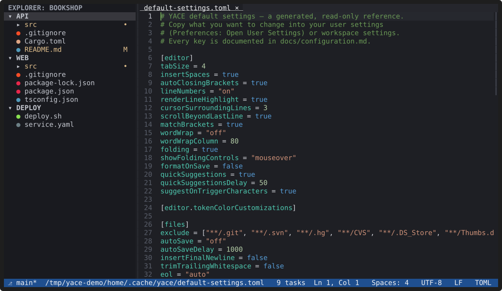
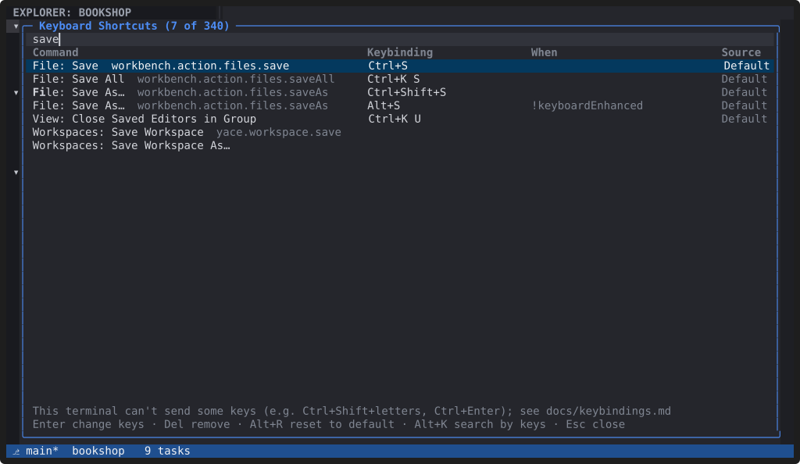

# Settings

**Your settings live in one TOML file, `~/.config/yace/config.toml`
(`Ctrl+,` opens it). Workspaces and repositories can override them with
VS Code's own settings files, and every change applies as soon as a file
is saved.**

## Layers

From lowest to highest:

1. built-in defaults;
2. your user settings, `config.toml`;
3. the `settings` of the `.code-workspace` file;
4. a folder's `.vscode/settings.json`, for files in that folder.

The workspace and folder layers use **VS Code's setting names**, so
existing projects keep working: YACE maps the keys it understands and
leaves the rest alone. Some settings are user-only: a workspace can never
choose which programs run (the terminal shell, language servers, plugins).

Each value is checked on its own. An invalid value is reported with its
file and key, and the next layer's value is used; "Developer: Show
Configuration Errors" lists every problem. If a file stops parsing, YACE
keeps its last good values until you fix it.

## Keyboard shortcuts

`Ctrl+K Ctrl+S` opens the Keyboard Shortcuts editor: every command, bound
or not, with its keys, its `when` clause and where the binding comes from.
Search by name or by pressing the keys (`Alt+K`), change a binding by
pressing the new keys, remove or reset it, and spot conflicts. Your
changes go to `~/.config/yace/keybindings.toml`, keeping your comments.

## Where everything is

| What | Where |
|---|---|
| Settings | `~/.config/yace/config.toml` |
| Key bindings | `~/.config/yace/keybindings.toml` |
| Your themes | `~/.config/yace/themes/` |
| Plugins | `~/.config/yace/plugins/` |
| Sessions, recent workspaces, log | `~/.local/state/yace/` |
| Cache | `~/.cache/yace/` |

`YACE_CONFIG_DIR`, `YACE_STATE_DIR` and `YACE_CACHE_DIR` move them.

The [Configuration](../docs/configuration.md) reference documents every
setting, and [Keybindings](../docs/keybindings.md) every shortcut.
