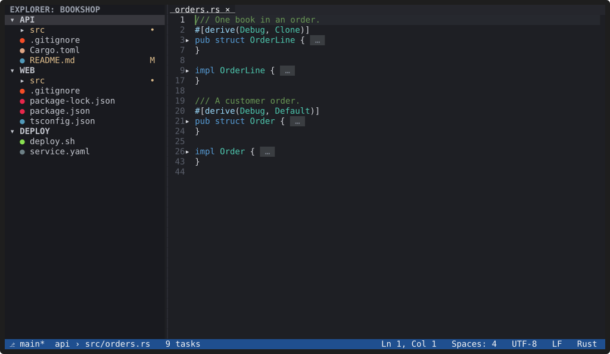

# Syntax and folding

**YACE highlights code with tree-sitter, folds by syntax, and wraps long
lines on request.**

## Highlighting

Rust, TypeScript and TSX, JavaScript and JSX, JSON, YAML, TOML, HTML, CSS,
Markdown, Python and Bash are built in, including languages embedded in
other languages. C, C++,
Go, Java, Ruby, SCSS, SQL and Dockerfile come from the grammar package
(see [Installation](../installation.md#optional-more-languages)), loaded
the first time you open such a file. Plugins can add grammars for more
languages.

Highlighting is incremental and covers only what's on screen. In a
10,000-line TypeScript file, re-parsing after a keystroke takes about
1 ms, and parsing a whole file happens on a worker thread so typing never
waits for it.

`files.associations` maps file names to languages, for example
`"*.mdc" = "markdown"`.

## Folding

Fold and unfold with `Ctrl+Shift+[` and `Ctrl+Shift+]` (`Ctrl+K Ctrl+L`
toggles), fold or unfold everything with `Ctrl+K Ctrl+0` and
`Ctrl+K Ctrl+J`, or click the `▾` and `▸` markers in the gutter
(`editor.showFoldingControls`).

## Word wrap

`Alt+Z` toggles word wrap for the window. `editor.wordWrap` sets the
default: off, at the window's width, at `editor.wordWrapColumn`, or at
whichever is smaller.

## Large files

Files larger than `files.largeFileThresholdMb` (50 MiB) open, after you
confirm, without highlighting, wrapping or folding, so even very large
files stay responsive.
