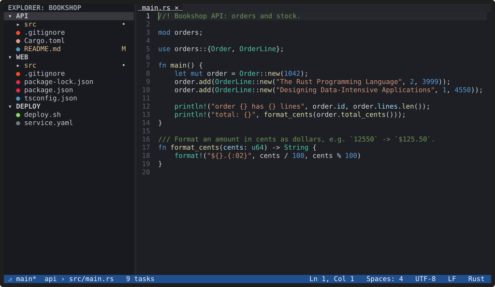
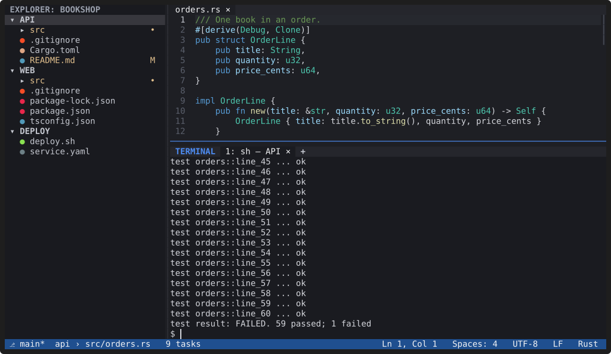
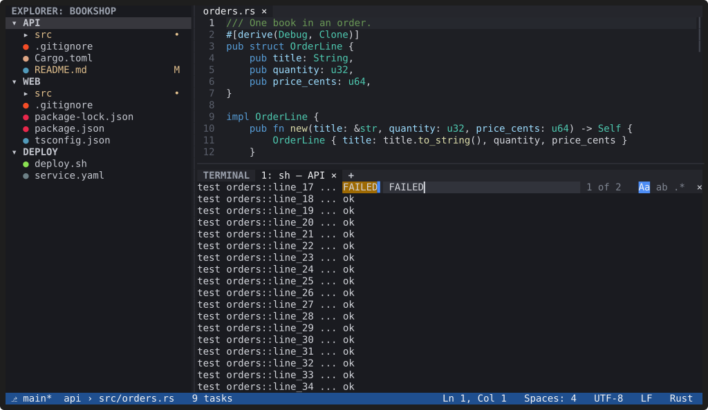

# Integrated terminal

**`` Ctrl+` `` opens a real shell in the bottom panel, started in the
active file's workspace folder. Terminals have tabs, can be split side by
side, and `Ctrl+F` searches their output.**

## Split terminals

`Ctrl+Shift+5` (or `Alt+\` without the enhanced keyboard protocol) starts
a new shell beside the focused one, in its current folder. `Alt+Left` and
`Alt+Right` move between panes; `Ctrl+Shift+Left` and `Ctrl+Shift+Right`,
or dragging the divider, resize them. Each pane has its own size, so
full-screen programs draw correctly. A split is one tab; "Unsplit
Terminal" moves a pane to its own tab, and splits are restored with the
session. When a terminal isn't split, those keys go to the shell.

*Recording: open the terminal, split it, run a command in each pane.
[asciicast](../media/terminal-split.cast)*

## Find in the terminal

`Ctrl+F` in a terminal opens a find bar at the top right of the pane and
searches the screen and the scrollback. The newest match is selected
first, so `Ctrl+C` copies it. `Enter` (or `F3`) goes up to older output,
`Shift+Enter` (or `Shift+F3`) comes back down, and `Alt+C`, `Alt+W` and
`Alt+R` toggle match case, whole word and regular expressions. The search
runs off the UI thread, a thousand lines at a time, so neither typing nor
the shell's output waits for it.

*Recording: find "FAILED", turn on match case, go to the older match.
[asciicast](../media/terminal-find.cast)*

## Everything else

- **A shell per folder.** New terminals start in the active file's
  workspace folder (`terminal.cwd`); "Open Terminal in Workspace Folder…"
  picks one, and the Explorer's "Open in Integrated Terminal" uses the
  selected folder. Each tab shows its folder.
- **Tabs:** `` Ctrl+Shift+` `` opens another terminal, `Ctrl+PgDn` and
  `Ctrl+PgUp` switch between them, and tabs can be renamed, cleared and
  killed from the Command Palette.
- **Keys go to the shell.** While a terminal has focus, every key goes to
  the shell except a short list of editor commands (Quick Open, the
  Command Palette, the terminal and panel toggles, and a few more). Add
  your own with `terminal.commandsToSkipShell`.
- **Copy and paste:** select with the mouse; `Ctrl+C` copies a selection
  (and interrupts otherwise), `Ctrl+Shift+C` and `Ctrl+Shift+V` copy and
  paste.
- **Scrollback** of 10,000 lines per terminal by default
  (`terminal.scrollback`), with `Shift+PgUp`, `Shift+PgDn` and the mouse
  wheel.
- **Profiles:** named shells with their own arguments, environment and a
  startup command, for example one that starts Claude Code in the active
  folder. See [`[terminal]`](../docs/configuration.md#terminal).
- **Sessions:** terminal tabs (name, folder, profile) are restored with
  the workspace. A restored tab starts a new shell when you show it and is
  marked "(new session)": processes never survive quitting YACE.

Heavy output doesn't slow down the editor: with `seq 1 2000000` running,
typing in the editor stays under 1 ms per key (95th percentile). See
[Performance](../contributing/performance.md).

See the [terminal keys](../docs/keybindings.md#integrated-terminal).
