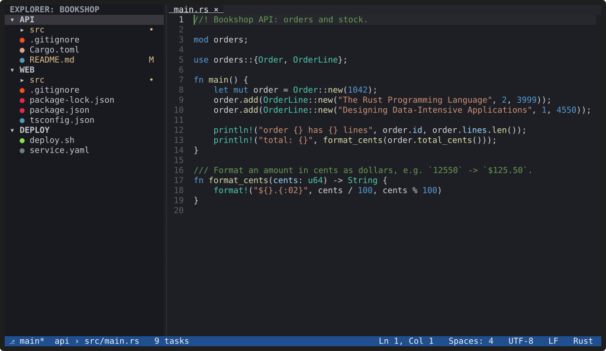
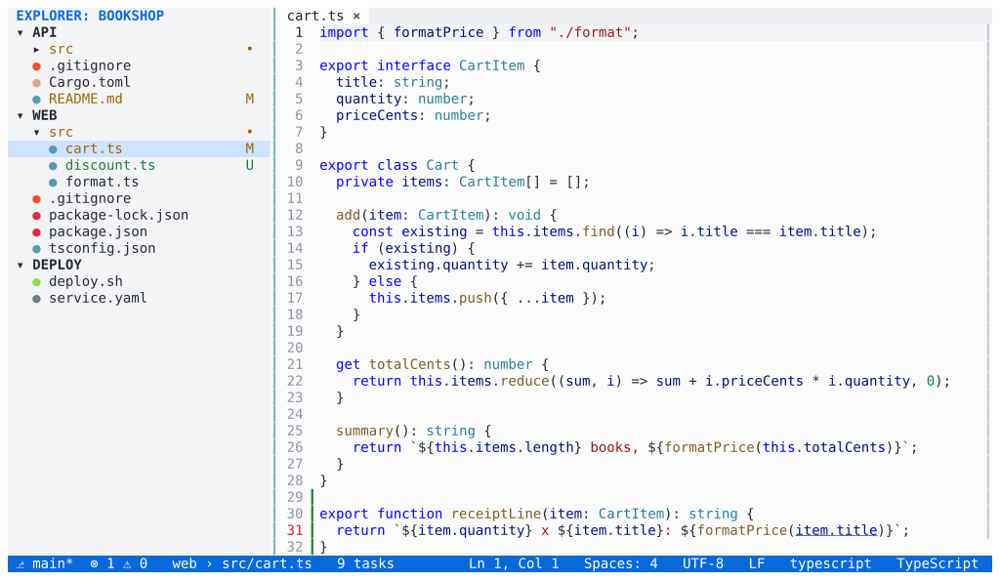

# Themes

**`Ctrl+K Ctrl+T` opens the theme picker; moving through the list
previews each theme on the whole window, `Enter` keeps it and `Esc` goes
back.**

*Recording: the theme picker previews each theme as you move.
[asciicast](../media/theme-picker.cast)*

## Built-in themes

YACE Dark (the default), YACE Light, One Dark, Dracula, Catppuccin Mocha
and Tokyo Night. The choice is saved as `workbench.colorTheme` in your
user settings, keeping your comments and layout. A workspace that uses a
VS Code theme name gets the closest built-in theme ("One Dark Pro" becomes
One Dark, for example).

## Make it yours

- **Override single colours** in your settings with VS Code's keys:
  `workbench.colorCustomizations` for the interface and
  `editor.tokenColorCustomizations` for code, optionally only for one
  theme (`"[Dracula]"`).
- **Write a theme** as a TOML file in `~/.config/yace/themes/`, starting
  from any built-in theme with `extends`. "Create Theme from Current"
  writes one for you.
- **Import a VS Code theme**: "Preferences: Import VS Code Color Theme…"
  reads the colour data of themes installed in VS Code, Cursor and similar
  editors, or a theme `.json` file, and converts it. No extension code
  runs.

## Any terminal

Themes are converted to what the terminal supports: true colour, 256
colours, the terminal's 16 colours, or none (`NO_COLOR` or
`workbench.colorDepth = "mono"`). Without colour, selections, matches and
problems are shown with reverse video, bold and underline, so nothing
disappears. Fonts belong to the terminal emulator; YACE chooses only which
characters it draws (`workbench.glyphs`).

The [Themes and colours](../docs/themes.md) reference lists every colour
key and syntax scope.
