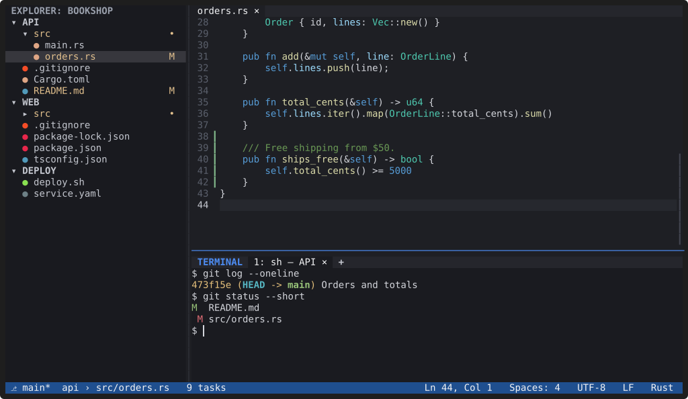

# Workspaces and sessions

**A YACE workspace is a set of folders that can live anywhere on disk. It
reads and writes the same `.code-workspace` files as VS Code and Cursor,
and it remembers your tabs, splits and terminals for next time.**

## Multi-root workspaces

- **Open a workspace file:** `yace ~/work.code-workspace`, or "Open
  Workspace from File…". YACE reads the JSON-with-comments format,
  including trailing commas, relative and absolute paths, custom folder
  names and `file://` URIs.
- **Combine folders on the fly:** `yace api --add-root ../web`, or "Add
  Folder to Workspace…" in the Command Palette. "Save Workspace As…"
  writes a `.code-workspace` file; until then the workspace is kept in
  YACE's state folder.
- **Edits are careful.** Adding, removing, renaming and reordering folders
  change only the `folders` array: comments, formatting, `settings` and
  every other field stay as they were. Removing a folder from a workspace
  never deletes anything on disk.
- **Missing folders** are shown as unavailable and never block the
  others; "Locate Missing Workspace Folder…" points one at its new place.
- **Everything is per folder:** each folder has its own Git repository,
  language servers, terminal folder and `.vscode/settings.json`, and
  Quick Open and search cover all of them.
- **Opening a workspace never runs anything from it.** `tasks`, `launch`
  and other executable configuration in workspace files are ignored.

## Sessions

YACE restores each workspace the way you left it: open tabs and cursors,
splits and their sizes, which Explorer folders were expanded, the side bar
and panel, and the terminal tabs (with new shells; processes don't survive
quitting). `yace` with no arguments reopens the most recent workspace,
`Ctrl+R` opens a recent one, and `--no-restore` starts a workspace without
its previous session.

"View: Reset Layout (Sidebar, Panel, Group Sizes)" restores the default
layout. On a small terminal YACE adapts instead of failing, down to a 1×1
window.

| Command | Keys |
|---|---|
| Open Folder… | `Ctrl+K Ctrl+O` |
| Open Recent… | `Ctrl+R` |
| Close Workspace | `Ctrl+K F` |
| Add Folder to Workspace…, Remove Folder from Workspace…, Rename Workspace Folder…, Move Workspace Folder Up / Down, Save Workspace As… | Command Palette |
