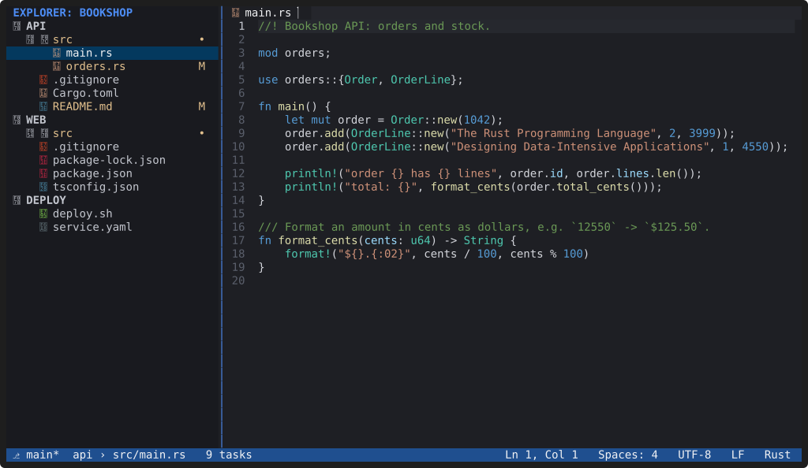

# Installation

**Build YACE from source with Cargo: `cargo build --release`, then put
`target/release/yace` on your `PATH`.** There are no prebuilt packages or
downloads yet.

## Prebuilt packages

None are published yet. The release workflow in the repository is ready to
attach Linux builds (`x86_64` and `aarch64` `.tar.gz` archives with
checksums) to GitHub Releases once the repository is public. A Debian
package, a signed APT repository and a Snap are planned for later.

## Requirements

- **Linux.** YACE is built and tested on Linux, and plugins are `.so`
  shared libraries.
- **A Rust toolchain** from [rustup](https://rustup.rs). The repository's
  `rust-toolchain.toml` selects the stable channel (with `clippy` and
  `rustfmt`), so rustup installs it for you. The code uses the 2024
  edition; the minimum supported Rust version is 1.88.
- **A C compiler** (`cc`, for example from `build-essential`): the
  tree-sitter grammars are C code compiled during the build.
- **Git**, if you want the Git features. YACE runs the `git` you have
  installed.

## Build

```sh
git clone https://github.com/abedmurrar/yace.git
cd yace
cargo build --release
./target/release/yace --version
```

The binary is `target/release/yace` (about 18 MB). Copy it to a folder on
your `PATH`, for example:

```sh
install -m 755 target/release/yace ~/.local/bin/yace
```

YACE keeps its files in the usual places: settings and plugins in
`~/.config/yace/`, session state in `~/.local/state/yace/`, and caches in
`~/.cache/yace/` (see [Configuration](docs/configuration.md#files-and-locations-xdg)).
To uninstall, delete the binary and those folders.

## Optional: more languages

Release builds highlight Rust, TypeScript/TSX, JavaScript/JSX, JSON, YAML,
TOML, HTML, CSS, Markdown, Python and Bash. C, C++, Go, Java, Ruby, SCSS,
SQL and Dockerfile come in a separate grammar package, which keeps the
editor binary smaller. Build and install it from the repository (it needs
a C compiler):

```sh
scripts/build_grammars.py            # writes dist/
yace --install-plugin dist/yace-grammars-<version>-<arch>.tar.gz
```

Until it is installed, those files open as plain text. Building YACE with
`--features yace-syntax/all-grammars` compiles every grammar into the
binary instead. See [Grammar package](docs/plugins.md#grammar-package).

## Optional: file icons

YACE never needs a special font. With a [Nerd Font](https://www.nerdfonts.com)
set in your terminal emulator, turn on coloured file-type icons in the
Explorer, Quick Open, tabs and Source Control:

```toml
# ~/.config/yace/config.toml
[workbench]
glyphs = "nerdFont"
```



*The icons are Nerd Font glyphs. If your browser has no Nerd Font, it
shows boxes here instead, which is also what a terminal without one would
show.*

## Optional: language servers

YACE starts language servers you have installed (`rust-analyzer`,
`typescript-language-server`, `gopls`, `clangd` and others) when you open
a file of their language. It never installs them. The list of servers it
knows, with install commands, is in
[Configuration: `[lsp]`](docs/configuration.md#lsp-user-settings-only).

## Your terminal

YACE adapts to what your terminal offers: true colour, 256 colours, 16
colours, or none (`NO_COLOR`). For every shortcut to
work, use a terminal with the enhanced keyboard protocol: Kitty, WezTerm,
foot, Alacritty 0.13 or later, or Ghostty. Elsewhere YACE offers
[fallback keys](docs/keybindings.md#fallbacks-active-only-without-the-enhanced-protocol).
The terminal emulator also decides the font and its size.
