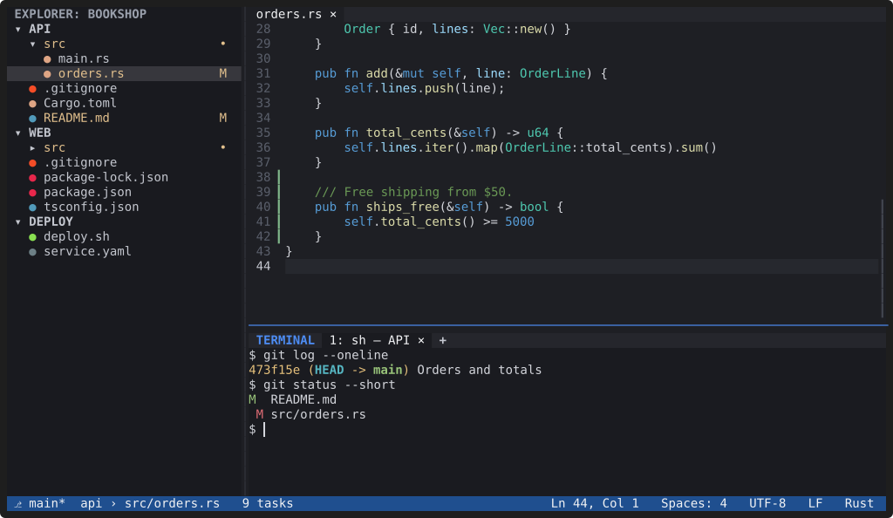
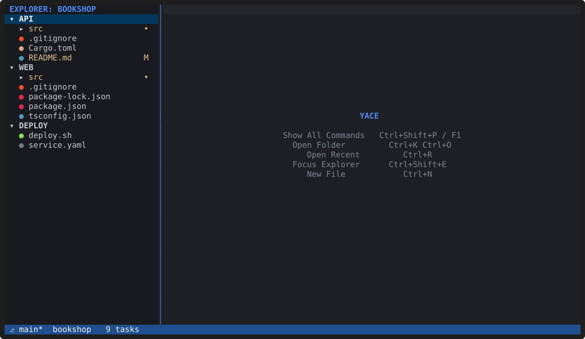

# YACE

**YACE (Yet Another Code Editor) is a fast code editor that runs in your
terminal and works like VS Code.** It uses the same keyboard shortcuts and
command names, and it opens the multi-root `.code-workspace` files that
VS Code and Cursor write, even when their folders live in completely
unrelated places on disk.

A 25-second tour: Quick Open, multiple cursors, completion from a language
server, search and replace across folders, and a split terminal.

## Why YACE

- **Light and fast.** YACE is a single native Rust program: no Electron,
  no Node.js, no JavaScript runtime. On a 44,000-file repository it draws
  its first frame in about 4 ms, needs about 8 MiB of memory at idle until
  you first use Quick Open, and
  uses no CPU while you're not typing. See [Performance](contributing/performance.md)
  for how this is measured.
- **Multi-root workspaces first.** Open several folders as one workspace.
  Each folder keeps its own Git repository, language servers and terminal
  folder, and Quick Open and search cover all of them.
- **Your VS Code habits carry over.** `Ctrl+P`, `Ctrl+Shift+P`,
  `` Ctrl+` ``, `Ctrl+Shift+F`, `F12`, `F2` and the rest do what you expect.
  Workspace settings use VS Code's setting names.
- **Local and private.** No account, no telemetry, works offline. Opening a
  workspace never runs anything from it.
- **Extensible.** Native plugins add commands, views, Quick Open
  providers, themes and grammars. See [Using plugins](plugins/using.md).

## What it can do

The editor covers the everyday workflow: VS Code-style editing with
multiple cursors, an Explorer per workspace folder, fuzzy Quick Open,
search and replace across the workspace with a preview, an integrated
terminal with tabs, split panes and find, tree-sitter syntax
highlighting and folding, language servers (completion, diagnostics, go to
definition, rename, formatting and more), Git per repository, themes, a
keyboard shortcuts editor, and sessions that come back the way you left
them. The [features overview](features/index.md) has the details and
screenshots.

## Status

YACE is before 1.0 and runs on Linux (x86_64 and arm64). Install it from
its APT repository, with the install script, or from a release archive
([Installation](installation.md)). Things that are still missing are
tracked in the project's `TODO.md`; the biggest is macOS and Windows
support.

## Where to go next

- [Getting started](getting-started.md): open a folder or a workspace and
  learn the handful of keys that matter.
- [Installation](installation.md): build YACE and set up your terminal.
- [Keybindings](docs/keybindings.md) and [Configuration](docs/configuration.md):
  the full reference.
- [Tutorial: write a plugin](plugins/tutorial.md).
