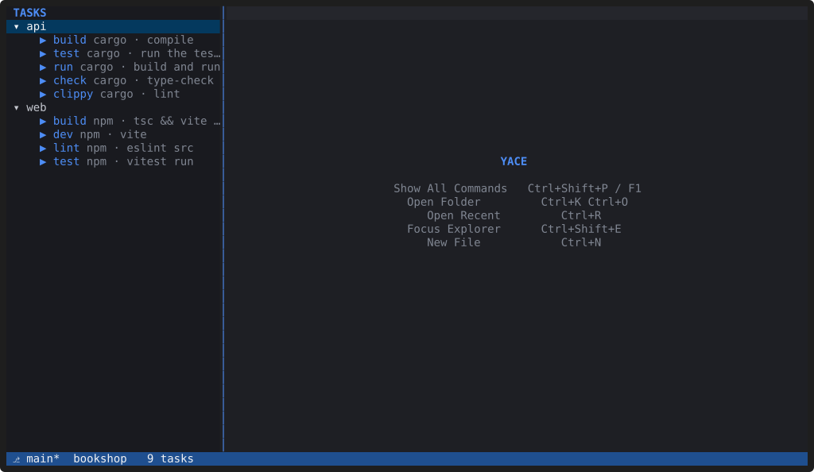
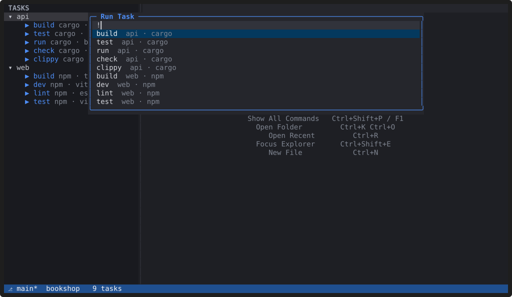
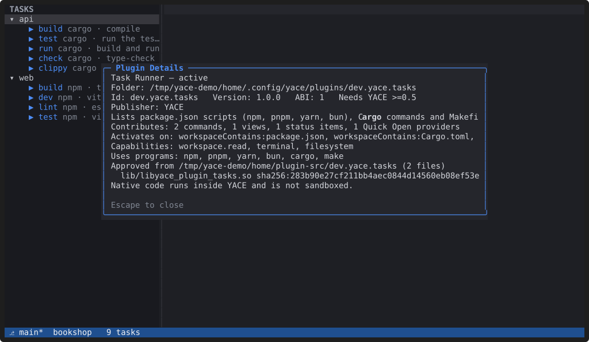

# Using plugins

**A YACE plugin is a manifest, with data (themes, settings) or a native
shared library. You install it from the plugin index, a package or a
folder; YACE shows you what it declares and the hash of its code, and
nothing loads until you confirm.**

> **Plugins are not sandboxed.** A native plugin runs inside YACE with
> your user's permissions: it can read and change your files, start
> programs, and crash the editor. YACE checks every call a plugin makes
> against the capabilities it declared, but it can't stop code that
> ignores the editor's API. Install only plugins you trust.

## Install one: the Task Runner

The repository includes the **Task Runner** plugin (`plugins/tasks`). It
lists every folder's `package.json` scripts (npm, pnpm, yarn or bun,
picked from the lock file), Cargo commands and Makefile targets, and runs
them in an integrated terminal of that folder. From a YACE checkout:

```sh
scripts/build_plugin.sh plugins/tasks
yace --install-plugin dist/dev.yace.tasks-1.0.0.tar.gz
```

The install prompt shows the plugin's name, publisher, the capabilities
it declares, the programs it runs and the SHA-256 of its code, and asks
before installing. Inside YACE, "Extensions: Install from Package…" and
"Extensions: Install from Directory…" do the same.



Its commands, view and status item appear right away, but its code loads
only when needed: here, when a folder contains a `package.json`,
`Cargo.toml` or `Makefile`. "View: Show Tasks" opens its view, and typing
`!` in Quick Open lists the tasks too.



## Browse and install published plugins

**"Extensions: Browse Plugins…"** lists the plugins published for YACE.
Pick one: YACE downloads it, checks it against the plugin index, and
shows the same install prompt as above. From a shell, install one by its
id:

```sh
yace --install-plugin io.github.abedmurrar.yace-themes
```

The list comes from the plugin index on this website,
[`plugins/index.json`](index.json). It holds each plugin's download link
and SHA-256: YACE refuses a download whose hash, id or version doesn't
match. Browsing and installing are the only times YACE uses the network,
and only when you ask. It downloads with the `curl` program
(`sudo apt install curl` if it's missing).

Plugins in the index:

<!-- plugin-index:start -->
| Plugin | What it is | Install |
|---|---|---|
| [Biome](https://github.com/abedmurrar/yace-biome) | Biome in YACE: lint problems, quick fixes and formatting for JavaScript, TypeScript, JSON, CSS and GraphQL. No plugin code. | `yace --install-plugin io.github.abedmurrar.yace-biome` |
| [ESLint](https://github.com/abedmurrar/yace-eslint) | ESLint in YACE: lint problems and quick fixes for JavaScript and TypeScript, using your project's ESLint and configuration. No plugin code. | `yace --install-plugin io.github.abedmurrar.yace-eslint` |
| [Vim](https://github.com/abedmurrar/yace-vim) | Vim keys in YACE: Normal, Insert and Visual modes, motions, operators, text objects, counts, registers, . repeat, macros, / search and :w :q :%s. Native code. | `yace --install-plugin io.github.abedmurrar.yace-vim` |
| [YACE Themes](https://github.com/abedmurrar/yace-themes) | Four colour themes: Retro Blue, Phosphor (green on black), High Contrast and Low Contrast. No plugin code. | `yace --install-plugin io.github.abedmurrar.yace-themes` |
<!-- plugin-index:end -->

Browse Plugins marks the ones you have installed, and offers the newer
version when there is one. To list your own plugin, see
[Publish a plugin](../docs/plugins.md#publish-a-plugin).

## Manage plugins

"Extensions: List Installed" lists every plugin with its state. Pick one
to show its details, enable or disable it (everywhere or only in this
workspace), approve its code, open its settings, show its log, or
uninstall it. From a shell, `yace --list-plugins` lists them.



- **Disable:** "Disable" adds the plugin to `plugins.disabled` in your
  `config.toml`; "Disable in This Workspace" is remembered in the
  workspace's session, and the `.code-workspace` file is never changed. A
  workspace can't enable a plugin.
- **Settings:** a plugin's settings go in your `config.toml` under
  `[plugin."<id>"]`. "Open Plugin Settings" adds the section with every
  default and its description. Values are checked against the types the
  plugin declares.
- **Trust:** YACE records the SHA-256 of every file of a plugin when you
  install it, and loads its code only while those hashes still match. A
  plugin changed on disk is listed but not loaded until you install it
  again or choose "Approve Its Code".
- **Safe mode:** `yace --safe-mode` (or `--no-plugins`) starts without
  loading any plugin code or plugin grammar.

## When a plugin misbehaves

YACE times every call into a plugin. A plugin that blocks the editor for
more than 100 ms is named once per session, one that panics is reported,
and after three crashes it is stopped for the session. If YACE exits
abnormally while plugins are loaded, the next start says which ones were
active. "Extensions: Show Performance" shows activation time and time
spent per callback.

To write your own, follow the [tutorial](tutorial.md); every manifest key
and the ABI are in the [Plugin reference](../docs/plugins.md).
